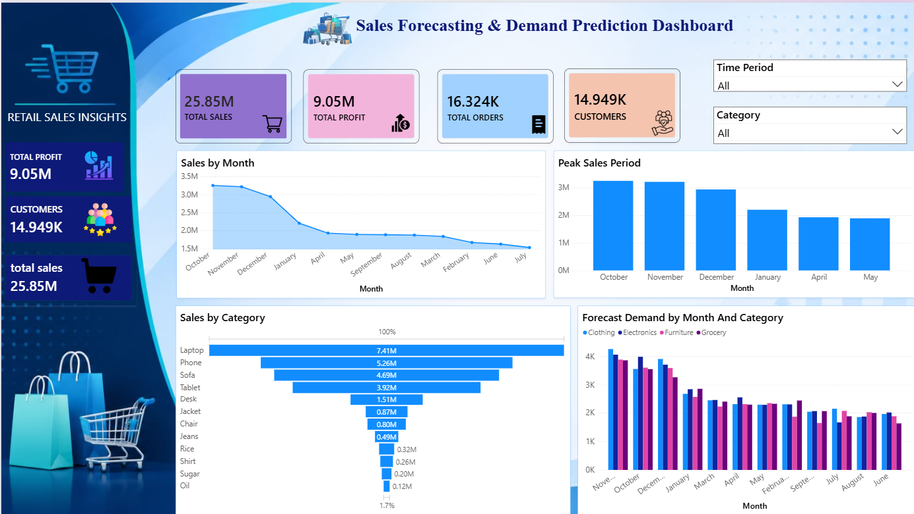

# 📊 Sales Forecasting & Demand Prediction Dashboard

An interactive **Retail Sales Analytics Dashboard** built using Microsoft Power BI to analyze sales performance, monitor business KPIs, understand customer trends, and visualize demand forecasts.

The dashboard transforms retail sales data into meaningful business insights through interactive visualizations, KPI cards, and dynamic filters.

---

## 📌 Project Overview

The Sales Forecasting & Demand Prediction Dashboard provides a centralized view of retail business performance.

It helps users understand sales trends, identify peak sales periods, analyze product categories, monitor profitability, and explore forecasted demand.

The dashboard is designed with a clean, modern interface to make business insights accessible and easy to understand.

## 🎯 Project Objectives

- Analyze overall retail sales performance.
- Monitor revenue, profit, orders, and customer metrics.
- Identify monthly sales trends and peak sales periods.
- Compare sales performance across product categories.
- Visualize forecasted demand across different months and categories.
- Provide interactive filters for better data exploration.
- Support data-driven business decisions.

## 🛠️ Technologies Used

| Technology | Purpose |
|---|---|
| Microsoft Power BI | Dashboard development and visualization |
| Microsoft Excel | Dataset storage and data source |
| Power Query | Data cleaning and transformation |
| DAX | Calculated measures and KPI calculations |
| Data Visualization | Business insights and trend analysis |

## 📈 Dashboard Features

### 1. Key Performance Indicators (KPIs)

The dashboard displays important business metrics:

- **Total Sales:** Overall revenue generated.
- **Total Profit:** Total profit earned.
- **Total Orders:** Number of unique orders.
- **Total Customers:** Number of unique customers.

### 2. Sales Analysis

- Sales by Month – Understand monthly revenue trends.
- Peak Sales Period – Identify high-performing sales periods.
- Sales by Category – Compare revenue across product categories.

### 3. Demand Forecasting

- Visualize forecasted demand by month.
- Compare forecast demand across product categories.
- Identify potential demand patterns and trends.

### 4. Interactive Filters

- Time Period – Explore sales performance across different dates.
- Category – Filter the dashboard by product category.

### 5. Dashboard Design

- Modern navy-blue sidebar.
- Clean blue-and-white dashboard theme.
- Interactive KPI cards.
- Professional charts and visualizations.
- User-friendly layout and navigation.

## 🖥️ Dashboard Preview

<!-- Add your dashboard screenshot here -->



## 📂 Project Structure

```text
Sales-Forecasting-Dashboard/
│
├── README.md
│
├── Dataset/
│   └── retail_sales_dataset.xlsx
│
├── Dashboard/
│   └── Sales_Forecasting_Dashboard.pbix
│
├── Images/
│   └── dashboard-preview.png
│
└── Assets/
    └── dashboard-background.png
```

*Update the folder and file names to match your actual GitHub repository.*

## ⚙️ How to Run the Project

1. Clone or download this repository.
2. Install Microsoft Power BI Desktop.
3. Download the Excel dataset from the `Dataset` folder.
4. Open the `.pbix` file from the `Dashboard` folder.
5. If prompted, update the Excel data source path.
6. Refresh the dataset.
7. Explore the dashboard using the interactive slicers and visualizations.

## 📊 Key Business Insights

The dashboard is designed to help identify:

- Monthly sales performance and revenue trends.
- High-performing product categories.
- Peak sales periods.
- Profitability patterns.
- Customer and order activity.
- Forecasted demand trends.

## 🚀 Future Enhancements

- Implement advanced Machine Learning forecasting models.
- Add sales growth and profit margin analysis.
- Introduce customer segmentation.
- Include top-performing products and regional sales analysis.
- Add forecast accuracy evaluation.
- Develop automated data refresh capabilities.

## 🎓 Project Information

**Project Name:** Sales Forecasting & Demand Prediction Dashboard

**Domain:** Retail Analytics / Business Intelligence

**Developed Using:** Microsoft Power BI and Microsoft Excel

**Project Type:** Data Analytics & Visualization

## 👨‍💻 Author

**Your Name**

Aspiring Data Analyst | Power BI | Excel | SQL | Data Visualization

---

⭐ If you find this project useful, consider giving this repository a star!

**Thank you for visiting this project!**
